

<h1>
  <picture>
    <source media="(prefers-reduced-motion: reduce)" srcset="public/assets/readme/monopoly-banner-still.svg">
    
  </picture>
</h1>

**像素城市大富翁 · 单机与多人联机**

和朋友掷骰出发，在城市之间买地、建设、收租，遇见每座城自己的故事。

[**在线游玩**](https://monopoly.the0xka1.cc) · [备用入口](https://monopoly-the0xka1.pages.dev) · [单机模式](https://monopoly.the0xka1.cc/?local=1)

**88 座城市　/　2–20 个联机角色　/　118 张事件卡　/　5 类公共事业**

## 像素城市，环形棋盘

MONOPOLY 是一款支持桌面和手机浏览器的像素风大富翁游戏。玩家掷骰穿行于城市之间，购买地产、建设升级、收取租金，通过交易和事件积累资产。可以独自与 AI 对局，也可以邀请朋友进入同一房间。

城市库收录 **58 座中国城市与 30 座世界城市**，每座城都有自己的像素地标。经典地图串联北京、西安、成都等 12 座城市；随机地图可选择中国、世界或混合范围，生成 20、28 或 36 格棋盘。

  
  
  
  

## 购买、建设与交易

城市可升级至 4 级，集齐同色组会提高租金，旅行季轮换会改变热门区域。除了城市，铁路、航空、航运、太空冒险和水利电力五类产业也能购买经营，同一业主的相关产业可以产生联动收益。

付租前可以向业主提出收购，弃购和破产释放的资产则进入密封拍卖。现金紧张时可以抵押资产，之后按原额赎回。随着轮次推进，起点补给逐步减少，产权争夺和递增经营费让长局中的现金安排更有分量。

  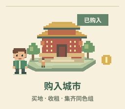
  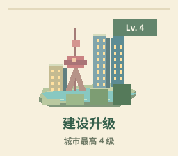
  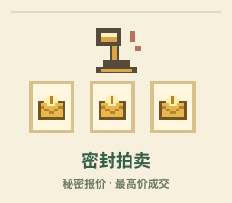

## 每座城市都有故事

**30 张通用奇遇卡与 88 张城市专属事件卡**带来旅行、红包、改建、财富转移与道具奖励。城市事件随地图组成卡池，玩家会遇见本局城市的故事。

遥控骰子可以选择落点，租金护盾抵挡一次城市租金，建设补贴降低升级支出。地图还可能在事件中洗牌、反转或轮转，人物与产权随城市一起移动。

  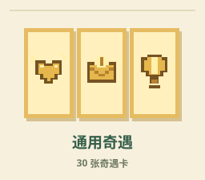
  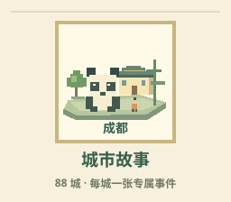
  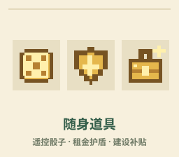

## 和朋友同桌

联机房间支持 **2～20 个角色，包含真人与 AI**。房主设置地图、轮数和 AI 人数，分享链接邀请朋友；所有真人准备后即可开局。对局自动保存，断线后可在原浏览器重连；决策超时由 AI 代行。

默认进行 20 轮，结束时按总资产结算；也可自定义轮数或选择无限轮模式，只剩一名玩家时提前结束。单机模式默认由一位玩家与三位 AI 同桌。

  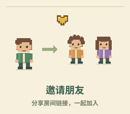
  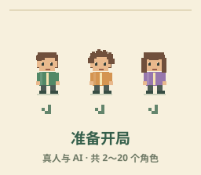
  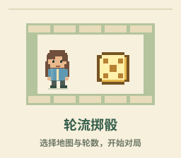

## 自己的小人，自己的节奏

角色的肤色、发型、发色、衣服、帽子、眼镜和配饰均可自由组合。像素小人在棋盘上逐格行走，购地、升级、收租和抽卡各有对应动画。

大厅、准备阶段、常规对局和后期经营分别配有循环音乐。音效与背景音乐可独立调节，界面适配桌面与手机，并支持系统减少动态设置。

  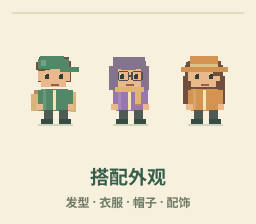
  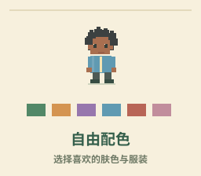
  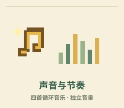

## 开始游戏

打开 [在线游戏](https://monopoly.the0xka1.cc)，输入昵称，创建房间并分享邀请链接；也可以输入朋友的房间号加入。想先熟悉玩法，可以从 [单机模式](https://monopoly.the0xka1.cc/?local=1) 开始。

欢迎通过 [GitHub Issues](https://github.com/The0xKa1/monopoly/issues) 反馈问题和玩法建议。
